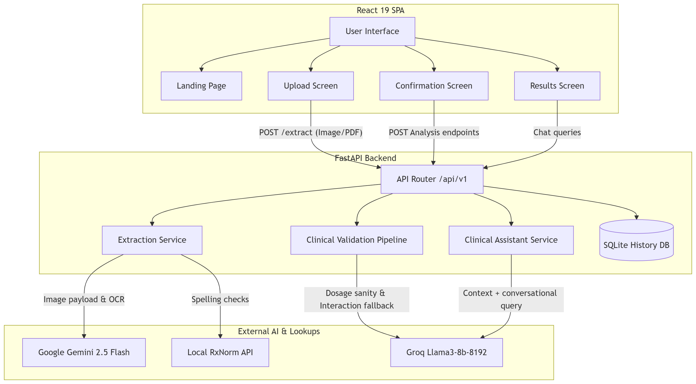
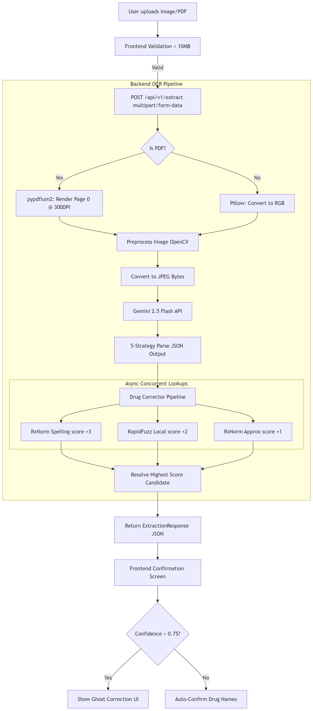
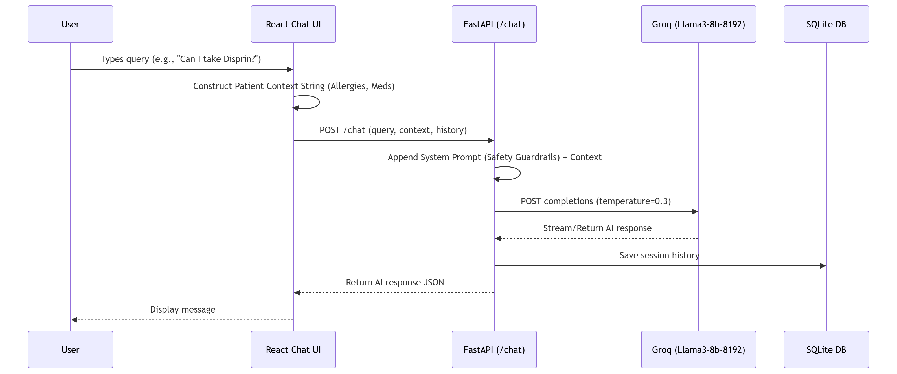
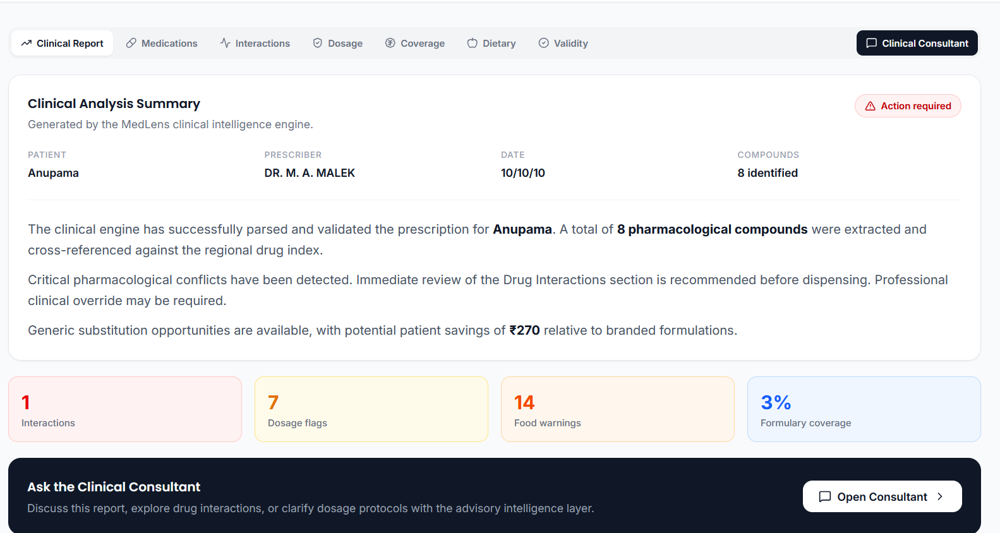
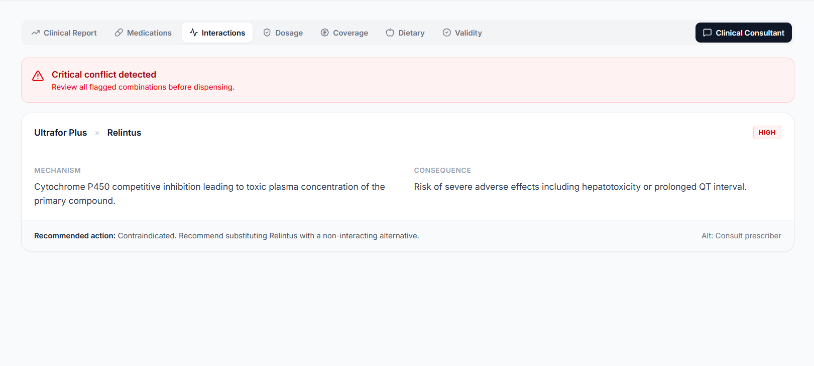
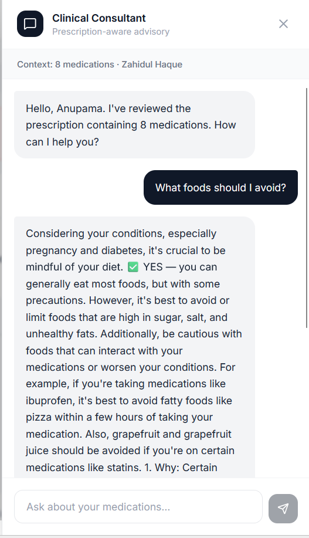

# MedLens AI

[](https://youtu.be/-zR9KAvdFew)


A prescription digitizer and conflict checker for the Indian healthcare context. MedLens AI reads handwritten prescriptions with a vision model, corrects drug names, and checks the result for drug interactions, dosage problems, and food warnings.

> **Disclaimer:** MedLens AI is a software project, not a medical device. Its output can contain errors and must be verified by a qualified doctor or pharmacist before any medication decision.

## Overview

Handwritten prescriptions can be difficult for patients to read and verify. MedLens AI turns a prescription image into structured data, then runs it through a series of clinical checks and presents the results in plain language, including a daily medication timeline. Users can also keep their prescription history and a shareable emergency medical card.

## Key Features

- **Prescription OCR:** extracts patient details, prescriber, drugs, dosage, frequency, and duration using Gemini 2.5 Flash
- **Drug name correction:** fuzzy matching against an index of 252 drugs used in India, using RapidFuzz
- **Interaction detection:** checks drug combinations against a curated database of 217 interaction records
- **Dosage sanity checks:** rule-based validation, with Groq as a fallback for drugs outside the rules
- **Food warnings:** dietary precautions for the prescribed drugs
- **Medication timeline:** converts shorthand such as BID or 1-0-1 into a daily schedule
- **Insurance summary:** coverage information and generic alternatives
- **Prescription validity check:** evaluates the completeness of a prescription
- **User accounts:** login, prescription history, and a health profile
- **Emergency medical card:** a public card page accessible through a QR code

## Technology Stack

| Layer | Technology |
| --- | --- |
| Frontend | React 19, TypeScript, Vite, Tailwind CSS 4, React Router |
| Backend | FastAPI, Uvicorn, Pydantic |
| Database | SQLite, SQLAlchemy |
| AI services | Google Gemini 2.5 Flash, Groq (`llama3-8b-8192`) |
| Text matching | RapidFuzz |
| Image handling | OpenCV, Pillow, pypdfium2 |
| Authentication | JSON Web Tokens, bcrypt |

## Architecture and Workflow

### Overall System Architecture



### OCR and Extraction Pipeline



### RxGuard Chatbot Architecture



## Project Structure

```text
MedLensAI/
├── backend/
│   ├── app/
│   │   ├── api/routes.py      API routes
│   │   ├── core/config.py     Application settings
│   │   ├── data/              Drug, interaction, and dosage data
│   │   ├── schemas/           Pydantic models
│   │   ├── services/          OCR, validation, and clinical checks
│   │   └── main.py            Application entry point
│   ├── .env.example
│   └── requirements.txt
├── frontend/
│   └── src/
│       ├── components/        Upload, processing, and results screens
│       ├── hooks/             Authentication hook
│       └── pages/             Application pages
├── architecture/              Architecture diagrams
└── screenshots/               Application screenshots
```

## Installation and Setup

### Prerequisites

- Python 3 and Node.js
- A Google Gemini API key and a Groq API key

### Backend

```bash
cd backend
python -m venv venv
```

Activate the virtual environment:

```bash
source venv/bin/activate      # Linux and macOS
venv\Scripts\activate         # Windows
```

Install the dependencies, create the configuration file, and start the server:

```bash
pip install -r requirements.txt
cp .env.example .env
uvicorn app.main:app --reload --host 0.0.0.0 --port 8000
```

### Frontend

```bash
cd frontend
npm install
npm run dev
```

The application runs at `http://localhost:5173`.

The frontend imports its API client and shared types from `frontend/src/lib/`, which the root `.gitignore` currently excludes. This directory must be present for the frontend to compile.

## Configuration

| Variable | Location | Purpose |
| --- | --- | --- |
| `GEMINI_API_KEY` | `backend/.env` | Prescription OCR and medical card generation |
| `GROQ_API_KEY` | `backend/.env` | Dosage validation fallback |
| `VITE_RXGUARD_URL` | Frontend environment | Address of the RxGuard chat service |

## Usage

1. Create an account and log in.
2. Upload a photo of a prescription.
3. Review and confirm the extracted details, correcting anything that was misread.
4. Review the interaction, dosage, and food warnings, along with the medication timeline.

### API Reference

All routes use the `/api/v1` prefix, except `/health`.

| Method | Path | Purpose |
| --- | --- | --- |
| POST | `/extract` | Run the OCR pipeline on a prescription |
| POST | `/validate-dosage` | Validate dosage plausibility |
| GET | `/interactions` | Look up interaction data |
| POST | `/check-dosage-sanity` | Check dosage for each drug |
| POST | `/check-interactions` | Detect drug conflicts |
| POST | `/check-prescription-validity` | Evaluate prescription validity |
| GET | `/drug-food-warnings` | Retrieve food warnings |
| GET | `/insurance-summary` | Retrieve insurance information |
| GET | `/timeline` | Build a medication timeline |
| POST | `/auth/signup`, `/auth/login` | Create an account or log in |
| GET | `/auth/me` | Retrieve the current user |
| GET | `/history` | Retrieve prescription history |
| GET, PUT | `/profile` | Read or update the health profile |
| GET | `/public/medical-card/{user_id}` | Retrieve a public medical card |

## Technical Implementation

### Client-Server Separation

API keys and clinical logic stay in the FastAPI backend, and the browser communicates only through its REST API. Responses are defined with Pydantic schemas.

### Clinical Data

Drug names, interactions, and dosage rules are stored as JSON files in `backend/app/data`, so they can be reviewed and extended without changing the code.

### RxGuard Chat

The frontend includes an RxGuard chat interface, which connects to a separate service configured through `VITE_RXGUARD_URL`. The source of that service is not included in this repository.

## Screenshots

### Clinical Report



### Drug Interaction Alerts



### RxGuard Chat



## Future Scope

- Expanded drug and interaction coverage
- Clinical review of the interaction and dosage data
- Support for additional languages
